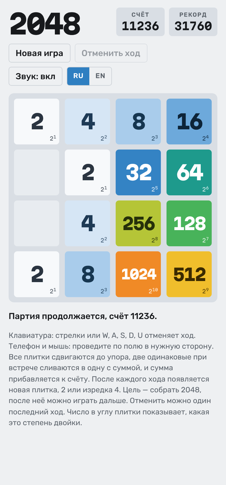
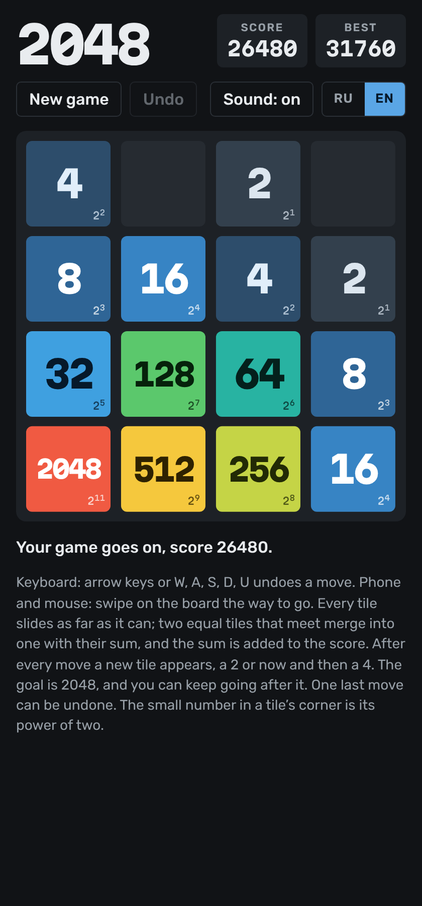

# 2048

[English version](README.md)

Головоломка со сдвигающимися плитками для браузера. Сдвигайте плитки, сливайте одинаковые числа и соберите плитку 2048. Чем больше число, тем «горячее» цвет плитки, как на тепловой карте.

**[Играть в браузере](https://posoxai.github.io/2048/)**

  
  

Слева светлая тема с русским интерфейсом, справа тёмная с английским.

## Правила

- Каждый ход сдвигает все плитки до упора в одну сторону.
- Две одинаковые плитки при встрече сливаются в одну с их суммой. За один ход плитка сливается только раз, поэтому 2 2 2 2 превращается в 4 4, а не в 8.
- Сумма каждого слияния прибавляется к счёту.
- После каждого хода на свободной клетке появляется новая плитка: 2 в девяти случаях из десяти, иначе 4.
- Плитка 2048 — победа. После неё можно играть дальше.
- Игра кончается, когда поле заполнено и никакие две соседние плитки не равны.

## Плитки

Цвет плитки зависит от числа, как на тепловой карте: бледно-голубой и холодный для 2 и 4, дальше синий, бирюзовый, зелёный, жёлтый, оранжевый, красный для 2048, а после неё малиновый и фиолетовый. Маленькое число в углу показывает плитку как степень двойки: 1024 это 2¹⁰, 2048 это 2¹¹.

## Отмена хода

Последний ход можно отменить, в том числе после окончания игры. Хранится только один ход назад.

## Управление

- Клавиатура: стрелки или W, A, S, D. U отменяет последний ход.
- Телефон и мышь: проведите по полю в нужную сторону.

Поле, счёт, рекорд и ход для отмены хранятся в браузере игрока, поэтому после перезагрузки игра продолжается.

## Язык

Интерфейс на русском и английском. Русский включается сам, если он есть в списке языков браузера, иначе игра открывается на английском. Переключатель RU/EN запоминает выбор.

## Как запустить

Вся игра лежит в одном файле `index.html`. Сборка и зависимости не нужны.

- Локально: откройте `index.html` в браузере.
- По ссылке: игра опубликована через GitHub Pages по адресу https://posoxai.github.io/2048/. Каждый коммит в `main` обновляет её автоматически.

Шрифты загружаются с Google Fonts. Без сети игра работает на системных шрифтах.

## Счётчик посещений

Опубликованная страница считает посещения через [GoatCounter](https://www.goatcounter.com/). По словам сервиса, он не ставит cookies и не хранит личных данных. Когда `index.html` открыт с диска, счётчик не работает.

## Авторство

Игру написал Claude, ИИ-ассистент компании Anthropic: логику, анимацию плиток, звук и оформление страницы.

Правила взяты из 2048 Габриэле Чирулли (2014). Цвета, отметки степеней двойки и оформление этой версии свои.

Идея сделать браузерную версию принадлежит posoxAI.

## Лицензия

MIT. Полный текст в файле [LICENSE](LICENSE).
